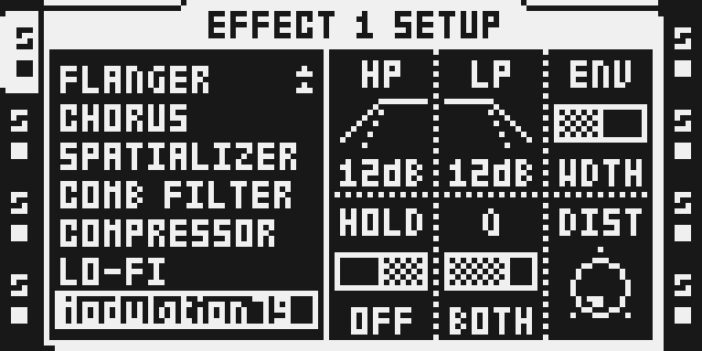
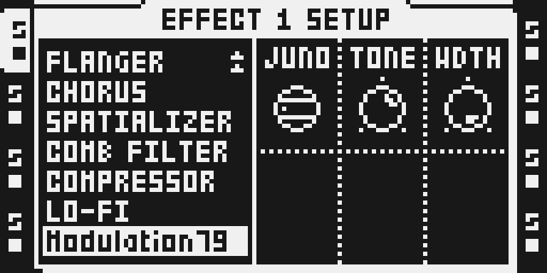
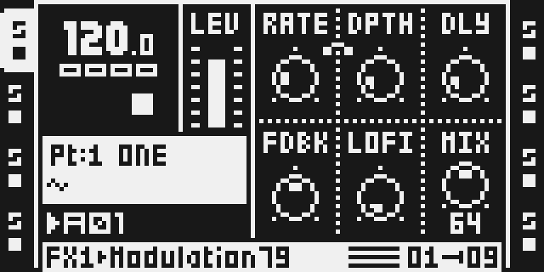
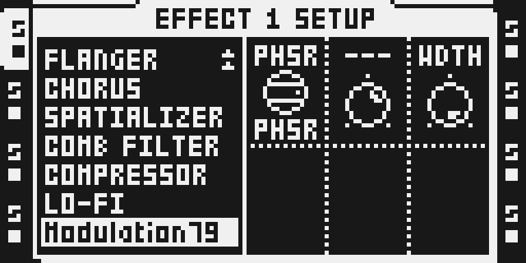

# MODULATION

## Overview

Modulation is an FX1 effect with five modulation voices in one slot: JUNO
(a Juno-60 style chorus), DIM (a dimension-style chorus), FLNG (a
through-zero flanger), COMB (a tuned comb that rings like a plucked string)
and PHSR (a 2 to 8 stage phaser). Shape the movement with RATE and DPTH,
then set feedback, tone, stereo width and the dry/wet blend. MIX starts at
0, so assigning it changes nothing until you turn MIX up.

Version 0.1.2-experimental takes Sam Banks' newer octabam source: the same
sound, bit for bit, at a lower DSP cost, with no uninterruptible `rep`
loop left in its code. It also loads over USB on the Modwerk base.

## Controls

| page | encoder | knob | range and default | what it does |
|---|---|---|---|---|
| main | A | RATE | 0–127, default 26 | LFO speed, 0.08 to 10 Hz on a squared taper (26 is the Juno's 0.5 Hz). No LFO in COMB |
| main | B | DPTH | 0–127, default 21 | how far the sweep moves either side of DLY; in PHSR, how far the LFO reaches. Unused in COMB |
| main | C | DLY | 0–127, default 18 | the sweep's centre, 0.2 to 23 ms; COMB's pitch; PHSR's stage count (STGS: 2, 4, 6 or 8) |
| main | D | FDBK | 0–127, default 64 | bipolar, 64 is none: feedback from the swept tap; PHSR's regeneration; COMB's decay time and polarity |
| main | E | LOFI | 0–127, default 0 | coarser and grittier: holds and quantises the line (0 is clean) |
| main | F | MIX | 0–127, default 0 | dry/wet; 0 is the exact dry track, 127 the effect alone |
| SETUP | A | MODE | JUNO, DIM, FLNG, COMB, PHSR | which voice; the knob names follow the mode |
| SETUP | B | TONE | 0–127, default 80 | the line's brightness, 0 dark (2 kHz) to 127 open; COMB's brightness; unused in PHSR (shown ---) |
| SETUP | C | WDTH | 0–127, default 127 | stereo spread of the LFO: 0 mono, 64 quadrature, 127 antiphase. Unused in COMB |

The laws behind each knob are in [The knobs](#the-knobs) below.

## Usage

Modulation sits in the FX1 chooser of an audio track, after the stock FX1
effects. On a card build it is there whenever the build includes it; on the
Modwerk base it is there once the module set that holds it is on the unit.

### Quick tutorial

1. Select an audio track, hold FUNC and press FX1, then turn LEVEL to Modulation and press YES.
2. Press FX1, turn encoder F (MIX) to 64 while a sample plays, then raise encoder B (DPTH) for a deeper chorus.
3. Hold FUNC and press FX1 and turn encoder A (MODE) to FLNG or PHSR for another voice; set MIX to 0 to hear the exact dry track again.

## Compatibility and limitations

- FX1 only. On an FX2 slot its code passes the track through dry by design.
- Its own effect id (11), so stock CHORUS stays available beside it.
- One instance per track, so up to four per DSP core (tracks 1–4 on one
  core, 5–8 on the other). Four cost 1,320 of a core's 3,120 cycles per
  sample at the static count; what the stock and other effects on that core
  leave free decides the rest, and the base refuses a pick that does not fit.
- Card builds refuse it beside Analog BD, as they do every custom DSP effect
  not on Analog BD's reviewed list.
- Knob names follow the MODE of the track that last drew the SETUP page:
  with T1 in COMB and T2 in JUNO, selecting T2 keeps COMB's names until you
  open SETUP (octabam's mode names live in one descriptor shared by every
  track). The sound always follows each track's own MODE.
- Changing MODE resets the per-sample state of the walk; the delay lines,
  the LFO phase and the LOFI hold keep running.
- Parts saved before ENS was removed (16 Sep 2026) read MODE 3..5 one lower;
  see [Open](#open).
- Paused in the Modwerk library since 1 October 2026 after reported audio
  crackling. 0.1.2 removes the `rep` loop that Modwerk's hardware traps name
  as a cause of torn audio; whether it ends the crackle is decided on
  hardware and by the owner.

## Tests and measurements

[TESTING.md](TESTING.md) has every command and result for this version:
bit identity with 0.1.1 on octabam's 13-setting matrix, Modulation's 26
render gates, the static cycle counts, the package and USB-package builds,
the emulator runs and the hardware report (one MKI, from a card image: eight
instances without audible crackle, scenes and a reboot fine). In short: the same sound as
0.1.1, LINE 330, COMB 291 and PHSR 298 cycles per sample (was 354, 329,
298), and a 7,386-byte stock-free USB package.

## Authorship and licences

Modulation is Sam Banks' module from octabam
([sambanks/octabam](https://github.com/sambanks/octabam), `modules/modulation`
at `8250be0`). Its modes transcribe permissively licensed work: Hera
(J.P. Cimalando, ISC), ChowPhaser (Jatin Chowdhury, BSD-3-Clause) and
Mutable Instruments Rings (Emilie Gillet, MIT). Project code is MIT; the
full notices are in [LICENSE](LICENSE). The import record is
`sdk/imports/modulation-8250be0.json`.

## Screens and audio

Headless emulator captures of 0.1.2-experimental on the MKI panel
([capture record](media/capture.json), [rights](media/LICENSE.md)):

No audio previews yet.

## Sources and design

A modulation pedal on its own id 0x0b (stock CHORUS's 0x12 until 30 Sep 2026), FX1 only. Every mode is a
transcription of a published, permissively licensed source; the survey,
licences and laws are in `docs/effects/PORTS.md`.

| page 1 | RATE ⌐DPTH · DLY · FDBK · LOFI · MIX |
|---|---|
| page 2 | MODE (JUNO DIM FLNG COMB PHSR) · TONE · WDTH · — · — · — |

| mode | source | licence | what it is |
|---|---|---|---|
| JUNO | jpcima `HeraChorus.dsp` + pendragon-andyh's Juno-60 measurements | ISC | two BBD lines on one triangle LFO, R inverted; I 0.513 Hz / II 0.863 Hz over 1.5..5.4 ms; I+II 9.75 Hz mono; dry 0.83 + wet 1.0 |
| DIM | Roland SDD-320 service notes + measurements | laws | antiphase lines, the other side's wet through a highpass, a bass lift on the dry; 0.25 / 0.5 Hz, 5..12 ms. The amounts (0.25 same-side, −1 cross, 0.5 lift, 200 Hz one-poles) are unpublished: **ours** |
| FLNG | Dattorro, *Effect Design Part 2* (JAES 1997), Table 6 | paper | blend 0.7071 of the dry read from a FIXED tap at the sweep's centre, feedforward −0.7071 of the swept tap (through-zero: the sweep crosses the dry and nulls), feedback −0.7071 |
| PHSR | ChowPhaser (Schulte Compact Phasing A) | BSD-3 | two RC allpasses (15 nF) with feedback, then 2/4/6/8 allpasses (25 nF) on one coefficient from the LDR's law (`R = 100k (light/0.1)^-0.75`, light = 20.1 − 20·lfo); the coefficient decoded per block from two 33-word tables and ramped per sample; the feedback closes through one sample; no tanh |
| COMB | Mutable Instruments Rings `string.h/.cc` | MIT | a Hermite-read loop tuned by DLY, a 3-tap FIR damping filter (brightness = TONE), the per-pass gain from a DECAY TIME (rt60 = 0.07 s · 2^(8·lf), lf = d(2−d)) so every pitch rings for the same time; no IIR damping (the MIC_W build's omission), no dispersion. FDBK's sign is the polarity: **ours** |

Every mode outputs the wet only and MIX blends, so MIX 0 is an exact
passthrough and MIX 127 the wet outright. Each mode carries an output trim
that levels it with JUNO at the views (16 Sep 2026, measured on the pad and
the loop stems): DIM −8 dB (its five weights scaled), FLNG −7 (blend and
feedforward scaled; the feedback is FDBK's), PHSR −2 (the selected stage
weight), COMB −12 (on the parked wet, after the line write, so the ring is
untouched). After the trims, active RMS against JUNO: DIM −1.9 / +2.6
(pad / loop), FLNG −1.9 / +2.8, COMB +11.8 / +2.4, PHSR −1.4 / +4.5.

ENS (the Solina, jpcima `string-machine`) was mode 2 until 16 Sep 2026:
Sam heard the 6 Hz component as "super unnatural and dominating" and the
slow-only form as bad, and jpcima's own chorus on the same pad the same
way ("no good, lose it"). It is in history (`git log -- modules/modulation`).

## The knobs

| knob | law | in the modes |
|---|---|---|
| RATE | (k/128)² · 0x780 + 0x10 per sample in 2^23rds of a cycle: 0.08..10 Hz; 26 = 0.5 Hz | the LFO in JUNO/DIM/FLNG/PHSR; `---` in COMB (no LFO there) |
| DPTH | 480 · k/128 samples either side of DLY, clamped inside the line (≤ DLY − 8, ≤ 1015 − DLY) | the sweep; in PHSR the LFO's reach into the LDR's law (0..1); `---` in COMB |
| FDBK | bipolar, (k − 64)/64 | feedback from the swept tap into the line; the phaser's regen (clamped ±0.95); COMB's decay time (size) and polarity (sign) |
| MIX | k/128, 127 = 1.0 | |
| TONE | one-pole 0.25 + 0.75 · k/128, 127 = 1.0 (exact bypass); 0 = 2 kHz | the BBD proxy in AND out of every line (the Juno's ~10 kHz filters at 80); COMB's FIR brightness, drawn BRIT; `---` in PHSR |
| WDTH | the right channel's LFO lag, (k/128)/2 of a cycle: 0 mono, 64 quadrature, 127 antiphase | the Juno's and the Dimension's are antiphase; `---` in COMB |
| DLY | 8 + 992 · k/128 samples (0.2..23 ms), capped 1000 | the centre; MANL in FLNG; the pitch in COMB (a 33-word table, 1000..8 samples exponential = 44 Hz..5.5 kHz); STGS in PHSR (2/4/6/8 by quarters) |
| LOFI | hold 1 + 64·(k/128)² samples (1 at 0, 17 at 64, 64 at 127 = 690 Hz); bits 24 below 64, then 16 12 10 9 8 7 6 5 by eighths of the travel | at the LINE WRITE in JUNO/DIM/FLNG (the taps read through the stairs) and COMB (the ring recirculates it); on the wet in PHSR. One hold counter for both channels. 0 is bit-exact |

Each mode's ModeView re-defaults the knobs to its source's numbers (the
Juno's I, the Dimension's mode 1, Dattorro's flanger, ChowPhaser's, Rings
at a mid pitch).

## Structure

Three sample loops, one chosen per block (the pricer takes the worst): LINE
(JUNO, DIM and FLNG share it — the three differ only in five per-block
mix weights `bl bd ff kc kb`), PHSR, COMB. LOFI's hold + mask is inline at
its three sites per channel (L advances the shared counter and latches on
its compare, R latches on the counter reading 0; the mask keeps bit 23 so
the extension byte stays consistent and the store does not saturate), as
are the LFO and the MIX. Straight-line callees: `mo_tap` (the linear read,
blending toward the older sample; the fixed taps use it too since 26 Sep
2026, split per sample from the centre's run value; `mo_itap` is its
second entry), `mo_herm` (the 4-point Hermite read, scaled
1/16 inside), `mo_apst` (one allpass stage, x in and y out in x0 so a chain
passes it straight through; PHSR's eight mod stages carry it inline, two
per trip of a counted loop, since 27 Sep 2026), `mo_para` (the parabola
sine), `mo_tab` (the table read, per block). The one-poles are
`s' = c x + c' s` with `c' = 1 − c` streamed beside `c`. The PHSR chain runs at half scale for headroom (an
allpass cascade peaks above its input).

PHSR is the last MODE position so that dropping it would move no other
mode's stored byte; Sam kept it 16 Sep 2026 ("pretty good").

Two lines of 1,024 words from the FX1 slot's allocator buffer; an FX2
instance reads its base at init and runs as a dry pass (`Claims(fx1_only)`,
proven by the gates). A change of MODE clears the per-sample walk
(r7+$23..$3f); the write phase, the LFO phase, the LOFI counter and the
lines persist.

## Measured

- **On the unit, image 88 (Sam's MKII, 27 Sep 2026):** a fourth MODULATION
  beside the reverb overran the DSP; three fit. The cycle pass below
  prices four inside the budget, not measured on the unit since.
- **27 Sep 2026, the cycle pass** (PR: mod-cycles): pricer per loop LINE
  404 → 354, PHSR 394 → 298, COMB 339 → 329 words/sample; the rig's priced
  worst core 2,781 → 2,585 (four Characters beside the reverb now bound it;
  four JUNO + reverb + 3 sends 2,781 → 2,581), payload A FREE 87 → 138.
  Exact (13/13 `verify-ident` settings bit-identical): the walk pointers by
  `lua`, `mo_itap`/`mo_herm` read and step back in one move
  (`y:(r5)-n5,b`, a stock form), limited values moved straight into `y1`,
  one fixed-tap split shared by L and R (`n3`, `$44`). Within the bars, not
  bit-identical: LINE's eight one-poles as two products `c x + c' s` (c'
  streamed; the halved-difference form truncated one bit per sample) and
  PHSR's eight mod stages rolled two per trip with the stage inline (no
  limiting reload between the tap weights: one is set, the rest 0). Against
  main's render on the ident matrix the LINE settings differ by at most 6 LSB
  (−123 dBFS) and one PHSR setting by 1 LSB; every other setting is
  bit-identical. `verify_modulation` reference errors unchanged (JUNO
  2.33e-5 → 2.36e-5, PHSR hard 5.55e-5 → 5.53e-5); `make verify-knobs` 0
  flagged, 0 garbage-start flagged. Priced on a scratch edit, not applied:
  LOFI removed −18 words/sample in every loop (its inline hold and mask;
  LINE 336, PHSR 280, COMB 311); PHSR capped at 4 stages −68 (two trips of
  the roll: PHSR 230), which drops 6/8-stage phasing.
- **1,480 words** with the knob ramps (26 Sep 2026; payload A FREE 61 in
  the rig; pricer per loop LINE 404, PHSR 397, COMB 339 words/sample).
  Before them: 1,383 words (`make bus`, 23 Sep 2026; 1,352 on 22 Sep, 1,128 on 20
  Sep, LOFI added 16 Sep 2026: 1,044 before, 1,199 with ENS), payload A FREE
  673 in the rig; pricer per loop PHSR 393, LINE 372, COMB 321 words/sample
  (489 / 423 / 361 on 22 Sep; 525 / 446 / 359 before the pointer rewrite).
  23 Sep 2026: the allpass stage passes x0 straight through (its entry and
  exit copies went, 20 calls per sample), the LFO, LOFI and MIX bodies are
  inline, the fixed taps' centre is split into i and f per block, c200, the
  COMB period−1 and trim are stream words, and six parallel moves with
  stock precedent; 13 settings (every MODE × two knob sets, zeros, max)
  bit-identical (`make verify-ident MOD=modulation`). The rig's priced worst
  core (four PHSR beside the reverb) went 3,121 → 2,737 against 3,120
  usable. The loops are pointer-addressed since 22 Sep 2026 (PR #378):
  displaced moves per sample LINE 107, PHSR 136, COMB 116 → 0, the block's
  constants streamed at r7+$48 and the states walked from r7+$23; 15
  renders across every MODE bit-identical. A one-word displaced move runs
  3.98 cycles on the chip against 2.00 for a pointer move (probe 57,
  `docs/firmware/CHIP.md` §2), which the word count cannot show.
- `tools/verify/verify_modulation.py`, **29 gates, all PASS**: MIX 0
  bit-exact in every mode; an FX2 instance a bit-exact dry pass with the
  guard clean; every mode against `modulation_ref.py` on a stereo signal
  (max error ≤ 1e-4 where the law is linear; COMB's ring recirculates its
  rounding, 5.5e-4 against a 3e-3 bar); the Juno's sweep 1.56..5.10 ms and
  0.5 Hz; the through-zero null −138 dB; the phaser unity at FDBK 64; the
  comb's period at three pitches; LOFI against the reference at hold 7 / 24 bits
  (JUNO), hold 32 / 9 bits (PHSR), hold 64 / 5 bits (DIM), hold 40 / 8 bits
  through the ring (COMB) — the hold to the sample, the mask within one quantum.

- The LFO's increment is an integer count of 2^-23 cycles (the mpy keeps
  the integer part); the reference models that (a float increment drifts
  2.5 % at RATE 14).
- MIX 127 and TONE 127 are pinned to 1.0 so the through-zero null and the
  flanger's blend are exact (the knob word alone is 127/128).

## Heard

16 Sep 2026, on the emulator (`abkit`, the pad and loop stems, level-matched,
Sam listening): JUNO "good", DIM "good", FLNG "good" at RATE 8 (the view was
14: "slower please"), COMB "sounds like what you describe" — kept, PHSR
"pretty good". LOFI (same day): two placements rendered on JUNO over the
loop at 90 — on the wet before MIX, and at the line write — Sam: "c please"
(the line write). Not listened to on the unit.

## Open

- DIM's amounts are ours; the Juno's own asymmetry (R 1.51..5.40 ms vs L
  1.54..5.15) and the I+II shape ("sine-like") are not modelled.
- The tap read is linear (Dattorro's allpass or Airwindows' 3-point + air
  are the alternatives, `docs/effects/PORTS.md`).
- Stored parts: MODE bytes 3..5 (FLNG/COMB/PHSR) mean one lower since ENS
  went; the page-1 order is RATE DPTH DLY FDBK LOFI MIX, page 2 MODE TONE
  WDTH. `stamp-defaults` before play.

## Licence notices — 0.1.1-experimental

This documentation update preserves component copyright notices and full terms in
[LICENSE](LICENSE) and the [shared notice bundle](../../licenses/THIRD_PARTY_NOTICES.txt).
Applicable SPDX expression: `MIT AND ISC AND BSD-3-Clause`. Project MIT terms do not
replace the original component licences. DSP behavior has not changed or been
newly qualified by this notice update.
